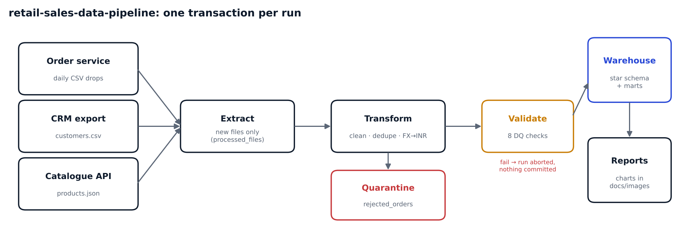
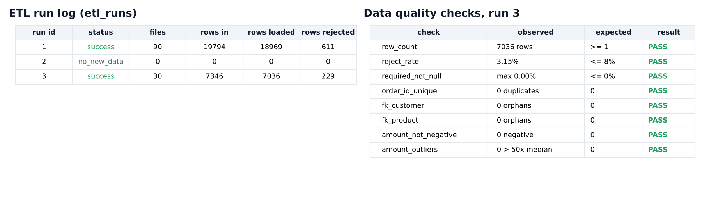
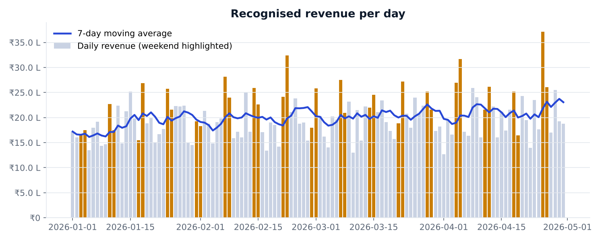
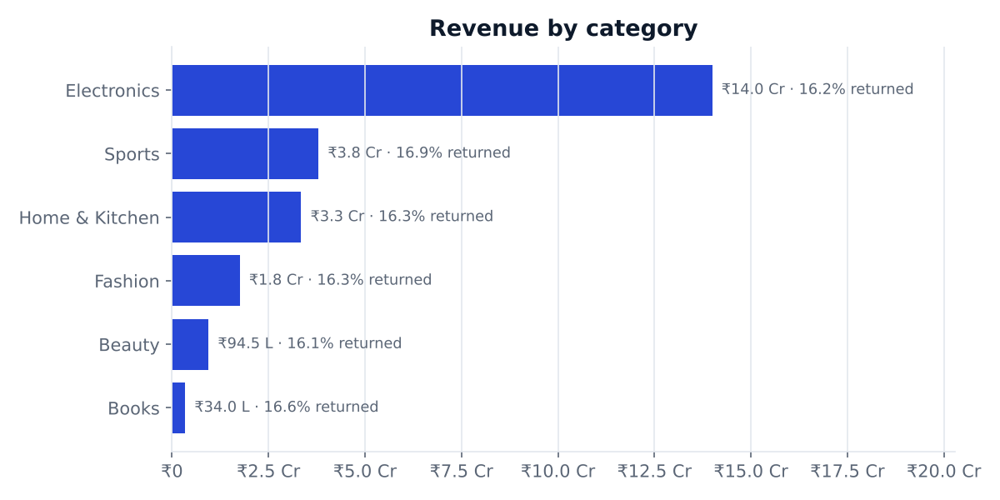
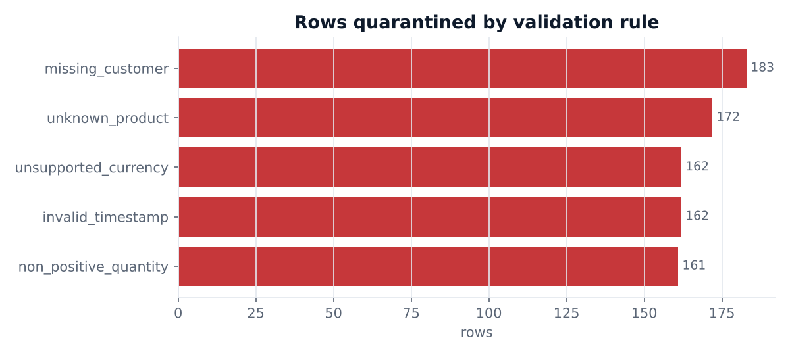

# Retail Sales Data Pipeline

[](https://github.com/vishavjit-singh/retail-sales-data-pipeline/actions/workflows/ci.yml)


An incremental batch ETL pipeline that ingests daily order drops, a CRM export and a product catalogue, cleans and validates every row, and loads a **star-schema warehouse** behind a **data-quality gate**. Each run is a single transaction, so a bad batch never half-lands. Rejected rows are quarantined with a reason instead of being dropped.



## Why this project

Real source systems are messy. Order services deliver duplicates, CRMs miss foreign keys, and someone always sends a timestamp as free text. This repo shows how I handle that in a production-style pipeline:

| Problem | How the pipeline handles it |
|---|---|
| Re-running a job double-counts sales | **Idempotent loads.** `processed_files` tracks what has been committed and facts are upserted on `order_id` |
| Only new files should be processed | **Incremental extraction.** Each run picks up only unprocessed daily files |
| At-least-once delivery creates duplicate orders | De-duplication on the business key, within a batch and against the warehouse |
| Bad rows silently disappear | **Quarantine table** `rejected_orders` with a reason and the raw record as JSON |
| A broken batch corrupts reporting | **8 data-quality checks** run before commit. A blocking failure aborts the run and nothing is written |
| Mixed currencies | Amounts normalised to INR using configured rates, keeping the original currency and rate |
| "What happened last night?" | **Audit trail** in `etl_runs` and `dq_results` |

## Results from the demo run

`make demo` generates 90 days of source data and loads them. It then simulates 30 more days arriving and loads only those. Every image below is produced by `python -m pipeline report` from the warehouse that run creates.

**Run log and data-quality gate.** Run 2 found nothing new and did nothing. Run 3 loaded only the 30 new files.



**Daily revenue** from the `mart_daily_revenue` view, with weekends highlighted and a 7-day moving average:



<table>
<tr>
<td></td>
<td></td>
</tr>
</table>

| Metric (demo dataset) | Value |
|---|---|
| Source rows read | 27,140 across 120 daily files |
| Rows loaded into `fact_sales` | 26,005 |
| Rows quarantined | 840 (≈3.1%) |
| Duplicate deliveries collapsed | 295 |
| Re-run on unchanged input | 0 rows written |

> The data is synthetic. It is generated by `pipeline/generate.py` with a fixed seed so results are reproducible. About 4% of order rows are deliberately corrupted to exercise the validation layer.

## Data model

```
                ┌──────────────┐
                │   dim_date   │
                └──────┬───────┘
┌──────────────┐  ┌────┴────────┐  ┌──────────────┐
│ dim_customer ├──┤  fact_sales ├──┤ dim_product  │
└──────────────┘  └─────────────┘  └──────────────┘
   grain: one row per order line  ·  revenue_inr = 0 for returned / cancelled

Operational tables: etl_runs · dq_results · processed_files · rejected_orders
Marts (views):      mart_daily_revenue · mart_category_revenue · mart_channel_month · mart_top_customers
```

DDL lives in [`sql/schema.sql`](sql/schema.sql) and the marts in [`sql/marts.sql`](sql/marts.sql). The schema is written in SQLite, but it ports to PostgreSQL with minor type changes.

## Data-quality checks

| Check | Rule | Severity |
|---|---|---|
| `row_count` | at least `min_rows` clean rows | error |
| `reject_rate` | rejected / input ≤ `max_reject_rate` (default 8%) | error |
| `required_not_null` | no nulls in key columns | error |
| `order_id_unique` | no duplicate business keys | error |
| `fk_customer`, `fk_product` | every fact row resolves to a dimension | error |
| `amount_not_negative` | no negative amounts | error |
| `amount_outliers` | flags rows above 50× the batch median | warn |

Thresholds are set in [`config/pipeline.yaml`](config/pipeline.yaml).

## Quickstart

```bash
git clone https://github.com/vishavjit-singh/retail-sales-data-pipeline.git
cd retail-sales-data-pipeline
python -m venv .venv && source .venv/bin/activate
make install
make demo          # generate → load → new data arrives → incremental load → charts
make test          # 13 tests: transforms, quality gate, idempotency, rollback
```

Query the warehouse directly:

```bash
PYTHONPATH=src python -m pipeline query "SELECT * FROM mart_category_revenue"
```

### With Docker

```bash
docker build -t retail-sales-pipeline .
docker run --rm -v "$PWD/data:/app/data" retail-sales-pipeline generate --days 30
docker run --rm -v "$PWD/data:/app/data" retail-sales-pipeline run
```

### CLI

| Command | What it does |
|---|---|
| `generate --days N` | Ensures N daily order files exist (existing days are never rewritten) |
| `run` | Loads every unprocessed file in one transaction; exits 1 if the quality gate fails |
| `report` | Renders the charts in `docs/images/` |
| `query "<sql>"` | Ad-hoc SQL against the warehouse |

## Project structure

```
├── config/pipeline.yaml      # paths, FX rates, quality thresholds
├── sql/
│   ├── schema.sql            # star schema + operational tables
│   └── marts.sql             # reporting views
├── src/pipeline/
│   ├── generate.py           # deterministic synthetic sources with injected faults
│   ├── transform.py          # cleaning, rejection reasons, dimensions
│   ├── quality.py            # data-quality checks
│   ├── run.py                # orchestration, incremental + transactional load
│   ├── report.py             # charts for this README
│   └── cli.py
├── tests/                    # pytest suite (unit + end-to-end)
├── Dockerfile
├── Makefile
└── .github/workflows/ci.yml  # lint, tests, demo run, docker build
```

## Testing

The suite covers more than the happy path:

- every rejection rule maps a bad row to exactly one reason
- duplicate deliveries are collapsed, and messy-but-valid values are repaired rather than rejected
- currency conversion, and zero recognised revenue for returns
- **idempotency**: a second run on unchanged input writes nothing
- **incremental loads**: only newly arrived files are processed
- **rollback**: when the quality gate fails, no facts and no file markers are committed, so the files are retried next run

CI runs lint and tests on Python 3.11 and 3.12. It also runs the full demo and builds and smoke-tests the Docker image.

## Roadmap

- [ ] PostgreSQL target behind a `--warehouse-url` option
- [ ] Orchestrate with Airflow (one task per stage, with SLAs)
- [ ] Slowly changing dimension (SCD type 2) for customer city and segment
- [ ] Partitioned Parquet staging layer

## Author

**Vishavjit Singh Saini**, Data Engineer
[Portfolio](https://vishavjit-singh.github.io/portfolio/) · [LinkedIn](https://www.linkedin.com/in/vishavjit-singh-7011211ab/) · [GitHub](https://github.com/vishavjit-singh)

## License

[MIT](LICENSE)
